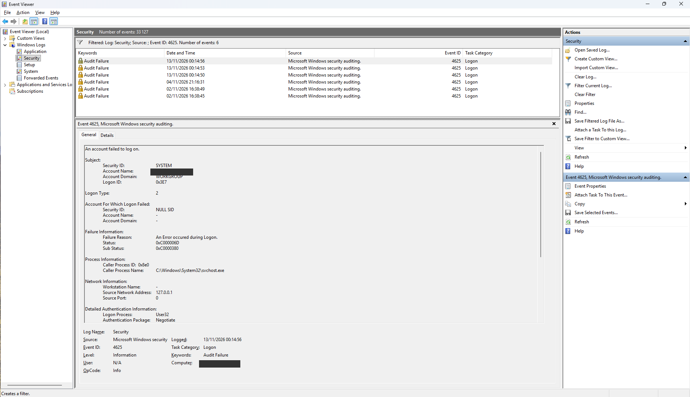
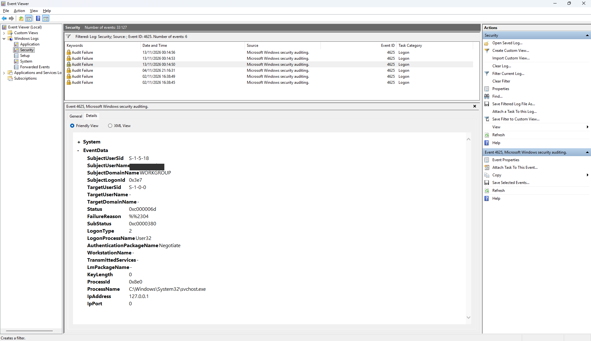

# Lab 01 — Windows Failed Logon Investigation

**Case ID:** SOC-LAB-001  
**Role:** Junior SOC Analyst (L1)  
**Environment:** Personal Windows workstation (local training lab)  
**Case date:** 2026-11-13  
**Classification:** Unconfirmed suspicious authentication activity  
**Outcome:** Inconclusive; no confirmed compromise

## Scenario

An analyst reviews a Windows Security log that contains several failed authentication events. The goal is to identify patterns and establish what the data *does and does not* prove. The organization in this scenario is fictional; the recorded security events are from a real local Windows log.

## Objectives

1. Locate failed Windows logons with Security Event ID **4625**.
2. Establish a time-based cluster and inspect event fields.
3. Determine whether the source is local or remote.
4. Record investigation limitations without fabricating a successful login or attacker identity.
5. Present privacy-safe evidence and an incident report.

## Evidence at a glance

- **6** Event ID 4625 entries were shown by the Event Viewer filter at the time of observation.
- **3** entries were clustered on **2026-11-13**, at **00:14:50**, **00:14:53**, and **00:14:56** (local event display time): **6 seconds** between first and last.
- Details were inspected for the **00:14:50** event. The filtered-list screenshot also displays the General tab for the **00:14:56** event. Do not assume every event shares exactly the same fields without validating each one.
- In the **00:14:50** entry: **Logon Type 2**, **Status 0xC000006D**, **Substatus 0xC0000380**, **Source IP 127.0.0.1**, **Process `C:\Windows\System32\svchost.exe`**, and target account not populated (`-`).
- PowerShell could read the Security log, but `Get-WinEvent` filtering for 4625 returned no matches during the attempted extraction. This discrepancy is unresolved.

## Screenshots (sanitized for public use)

### Event Viewer — six failed logons

### EventData — example at 00:14:50

A third capture, of the **00:14:53** event, was inspected during local installation review and remains in the private `screenshots/` directory. It is not included as public evidence; the field-level assessment above uses the public **00:14:50** capture.

## Investigation documents

- [Methodology](methodology.md)
- [Incident report](incident-report.md)

## Assessment

The short cluster warrants investigation; however, the inspected event points to **localhost** rather than a known external IP. Microsoft maps `0xC0000380` to `STATUS_SMARTCARD_WRONG_PIN`, which is an authentication failure code, not proof of malicious intent. Without validated target identity, session correlation, context, or independent telemetry, labeling this a brute-force attack would be unjustified.

**Final triage disposition:** *Insufficient evidence to confirm attack or compromise.*

## Reference documentation

- [Microsoft: Event 4625 — An account failed to log on](https://learn.microsoft.com/en-us/windows/security/threat-protection/auditing/event-4625)
- [Microsoft: NTSTATUS Values](https://learn.microsoft.com/en-us/openspecs/windows_protocols/ms-erref/596a1078-e883-4972-9bbc-49e60bebca55)
